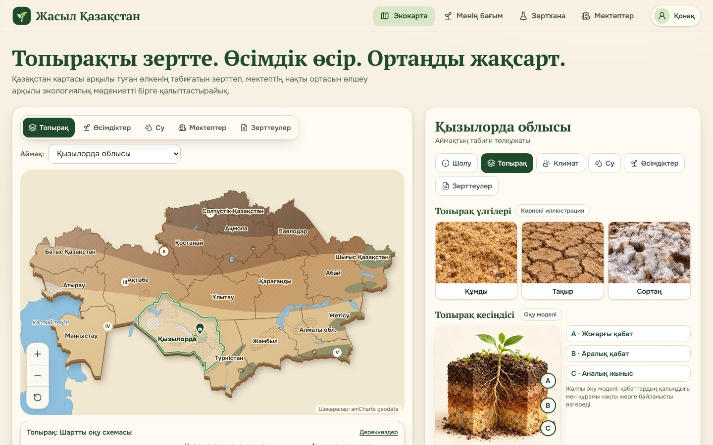
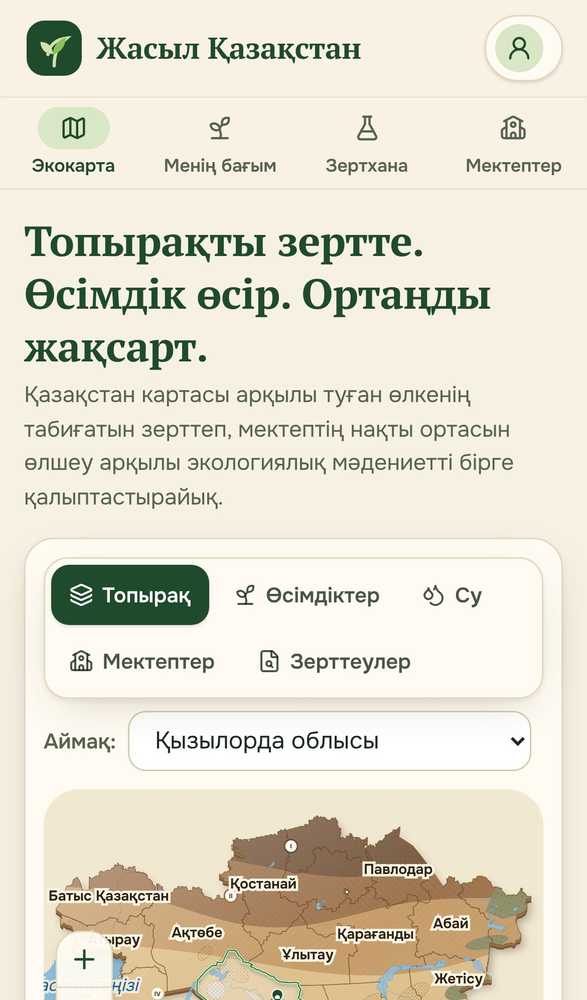
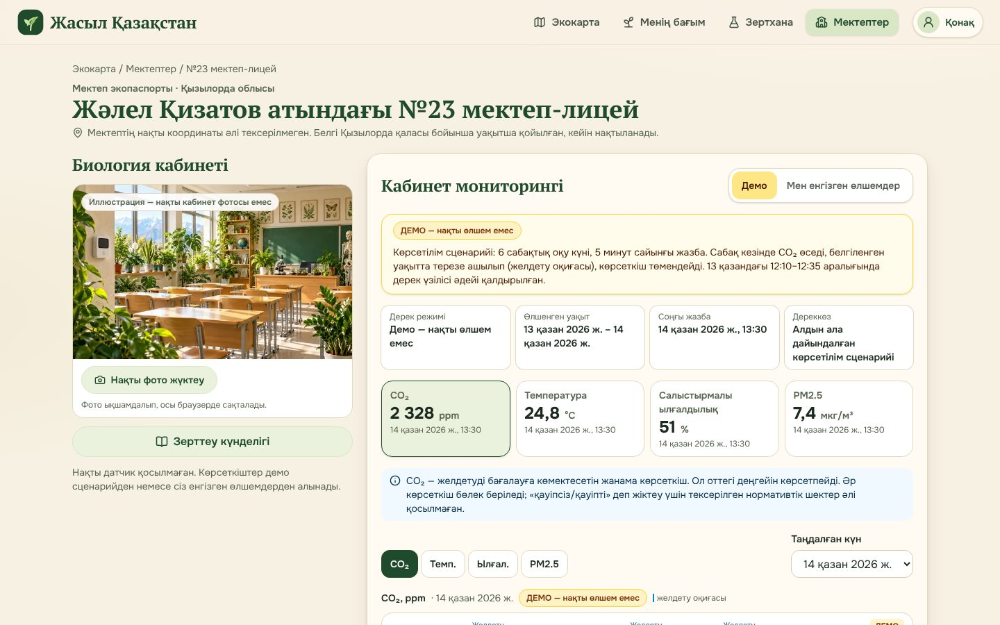
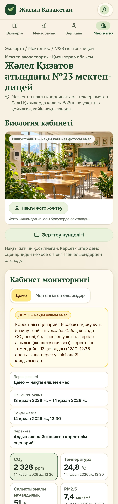

# Жасыл Қазақстан

Экологиялық білім беру платформасының алғашқы жұмыс нұсқасы (v0.1). Аймақтық биология және химия семинарына (2026 жылғы 24 қазан) арналып дайындалды. Интерфейс толығымен қазақ тілінде.



## Іске қосу

Қажет: Node.js 20.9 не одан жаңа нұсқасы.

```bash
npm install
npm run dev          # әзірлеу режимі: http://localhost:3000
```

Көрсетілімге арналған жылдам нұсқа:

```bash
npm run build
npm start            # http://localhost:3000
```

Басқа порт керек болса: `npm start -- -p 3100`.

Кодты тексеру: `npm run lint`.

## Не жұмыс істейді

### Интерактивті карта
- 17 облыс және 3 республикалық маңызы бар қала (Астана, Алматы, Шымкент) нақты шекара геометриясынан (SVG) салынған.
- Аймақты басып таңдау және ерекшелеу. Тінтуірмен жылжыту, Ctrl+доңғалақпен масштабтау, телефонда екі саусақпен масштабтау. «+», «−» және «Бастапқы көрініс» батырмалары бар.
- Аймақ атаулары масштабқа қарай өзгереді және бір-бірінің үстіне түспейді. Нұсқағышты апарғанда кеңес шығады.
- Пернетақтамен басқаруға болады (Tab, Enter, Esc, бағыт батырмалары). Картаның жанында аймақтар тізімі бар.
- Бес қабат бар: Топырақ, Өсімдіктер, Су, Мектептер және Зерттеулер.
- Топырақ қабаты әкімшілік шекарадан бөлек салынған және «Шартты оқу схемасы» деп белгіленген. Оның аңызы, өрнектері және дереккөздері бар.

### Аймақ панелі
- Бөлімдер: Шолу, Топырақ, Климат, Су, Өсімдіктер, Зерттеулер.
- Қызылорда облысы толық толтырылған: құмды, тақыр және сортаң топырақ суреттері, «Оқу моделі» белгісі бар топырақ қимасы, pH, ылғалдылық және EC көрсеткіштері (мән болмаса «Өлшем енгізілмеген» деп жазылады), «Топырақ үлгісін зерттеу» батырмасы.
- Қалған аймақтарда негізгі мәлімет (орталығы, ауданы) және «Мәлімет толықтырылуда» белгісі көрсетіледі.

### Топырақ үлгілері
- Толық форма: қосу, өңдеу және өшіру. Бос өріс ешқашан 0 болып сақталмайды.
- Координатасы бар үлгі картада белгіленеді, координатасыз үлгі тізімде ғана көрінеді.
- Әр үлгінің мәртебесі көрсетіледі: «Пайдаланушы енгізген» немесе «Демо үлгі».

### Мектеп және кабинет мониторингі
- Жәлел Қизатов атындағы №23 мектеп-лицей картада шамамен белгіленген, бұл туралы ескерту бар.
- Биология кабинетінің суретін нақты фотосуретпен ауыстыруға болады. Фото осы браузерде сақталады.
- Төрт көрсеткіш бар: CO₂, температура, ылғалдылық және PM2.5. CO₂ туралы ескерту көрсетіледі.
- Екі дерек режимі бар:
  - **Демо** (әдепкі). Тұрақты көрсетілім сценарийі, үнемі «ДЕМО — нақты өлшем емес» деп белгіленеді.
  - **Мен енгізген өлшемдер.** Қолмен енгізу немесе CSV импорттау арқылы толтырылады.
- Платформа «тікелей эфир» немесе «датчик қосулы» деп ешқашан көрсетпейді.
- Әр көрсеткіштің өз графигі бар (әдепкісі CO₂). Графикте желдету оқиғалары мен дерек үзілістері белгіленеді, бос мән нөл болып сызылмайды. Ең төмен, ең жоғары, орташа мән және өлшем саны көрсетіледі. Тексерілмеген түсті шектер қолданылмайды.

### CSV импорт және экспорт
Үлгі файлдың тақырып жолы:

```
timestamp,co2_ppm,temperature_c,humidity_pct,pm25_ug_m3,occupants,ventilation,note
2026-10-14 09:00,612,21.4,38,9.5,24,closed,1-сабақ басталды
```

- Кодтауы UTF-8. Бөлгіш ретінде үтір де, нүктелі үтір де қабылданады.
- Уақыт `YYYY-MM-DD HH:mm`, `DD.MM.YYYY HH:mm` немесе белдеуі бар ISO пішімінде жазылады. Белдеуі жазылмаған уақыт Asia/Qyzylorda (UTC+05:00) бойынша есептеледі.
- `ventilation` бағанына мына мәндердің бірі жазылады: `closed`, `window`, `door`, `window_door`. Желдету оқиғасын белгілеу үшін `airing` немесе `желдету` деп жазуға болады.
- Импорттың алдында алдын ала қарау көрсетіледі. Әр қатенің жолы мен себебі нақты жазылады.
- Бар деректерді ауыстырмас бұрын ескерту шығады.
- Күмәнді мәндер өзгертілмейді, тек тексеру үшін белгіленеді.
- Экспорт осы пішімде жасалады, уақыт `+05:00` белдеуімен жазылады.

### Басқа бөлімдер
- **Зерттеу күнделігі.** Платформа автоматты қорытынды жасамайды. Жайлылық туралы сауалнама жасырын жүргізіледі.
- **Өсімдіктер каталогы.** Сексеуіл, Жиде және Жусан карточкалары «Каталогтың бастапқы нұсқасы» деп белгіленген.
- **ЖИ экокеңесші (`/ai`).** Google Gemini арқылы жұмыс істейтін чат. Платформадағы тексерілген мәліметтерге (Қызылорда облысы, топырақ, өсімдіктер) және кабинет өлшемдерінің қысқа түйініне сүйеніп, қазақ тілінде жауап береді. Кілт тек серверде сақталады: `GEMINI_API_KEY` (Vercel → Settings → Environment Variables). Қажет болса, `GEMINI_MODEL` арқылы модельді ауыстыруға болады (әдепкі мәні `gemini-flash-latest`). Кілт берілмесе, бет ЖИ қосылмағанын хабарлайды.
- **Алдын ала қарау беттері.** Менің бағым және Зертхана беттерінде «Әзірленуде» немесе «Келесі кезеңде қосылады» белгісі тұр.
- **Деректерді басқару** (`/data`). Барлық енгізілген деректі JSON түрінде экспорттауға және растаумен толық өшіруге болады (растау сөзі: «ӨШІРУ»). Supabase режимінде өшіру тек редакторға рұқсат етілген.
- **Дереккөздер** (`/sources`). Барлық дереккөз қаралған күнімен көрсетіледі.
- Беттер компьютерде де, телефонда да дұрыс көрінеді. Пернетақта мен экран оқу бағдарламалары қолдау табады.

## Деректер қалай сақталады

Платформаның екі режимі бар:

- **Supabase (ортақ дерекқор).** `.env` файлында `NEXT_PUBLIC_SUPABASE_URL` пен `NEXT_PUBLIC_SUPABASE_PUBLISHABLE_KEY` берілсе, барлық енгізілген дерек (топырақ үлгілері, өлшемдер, күнделік, кабинет фотосы) Supabase-те сақталады. Оны кез келген құрылғыдан көруге болады, ал өзгерістер басқа құрылғыларда бірден көрінеді.
- **Жергілікті режим.** Айнымалылар бос болса (мысалы, `.env.local` файлында бос мән берілсе), дерек бұрынғыдай браузердің `localStorage`-інде сақталады. Бұл интернетсіз көрсетілім үшін ыңғайлы.

Сақтау қабаты бөлек модульде орналасқан (`src/lib/storage/repositories.ts`), компоненттер қай режим екенін білмейді.

### Supabase-ті баптау

1. Supabase-те жаңа жоба ашыңыз.
2. `supabase/migrations/` ішіндегі SQL файлын жобаның SQL Editor-ында орындаңыз. Ол кестелерді, қауіпсіздік ережелерін (RLS) және Realtime-ды баптайды.
3. Project Settings → API Keys бетінен мекенжай мен publishable кілтті алып, `.env` файлына жазыңыз. Реподағы `.env` файлында платформаның өз Supabase жобасы көрсетілген, сондықтан оны жүктеп алған соң бірден ортақ дерекқормен жұмыс істейді.
4. Сайтты қайта іске қосыңыз (`npm run dev` немесе `npm run build && npm start`).

### Кім не істей алады

- **Деректі көру** барлығына ашық, кірудің қажеті жоқ.
- **Енгізу, өзгерту, өшіру** тек редакторларға рұқсат етілген. Бұл шектеуді дерекқордың өзі (RLS) қамтамасыз етеді.
- Мұғалім сайтта «Мұғалім ретінде кіру → Тіркелу» арқылы аккаунт ашады. Содан кейін әкімші оны SQL Editor-да редакторлар тізіміне қосады:

```sql
insert into public.zk_editors (user_id)
select id from auth.users where email = 'mugalim@example.kz';
```

Бөгде адамдар деректі өзгерте алмауы үшін Authentication → Sign In / Providers бетінде жаңа тіркелуді кейін өшіріп қоюға болады.

## Құрылымы

```
src/
  app/            беттер: басты, /schools/[id], /journal, /data, /sources, /garden, /lab, /ai
  components/     карта, аймақ панелі, топырақ, датчиктер, мектеп, күнделік
  data/           аймақтар, өсімдіктер, мектептер, топырақ схемасы, дереккөздер, демо деректер
    geo/          дайын GeoJSON (региондар, су)
  lib/            уақыт, метрикалар, CSV, сақтау қабаты, Supabase клиенті, проекция
supabase/
  migrations/     кестелер мен RLS ережелері (SQL)
scripts/
  build-geo.mjs   GeoJSON-ды дайындау скрипті
  source-data/    amCharts бастапқы геометриясы және лицензиясы
public/images/    иллюстрациялар
docs/             дизайн макеті және скриншоттар
```

## Гео деректерді қайта жасау

`src/data/geo/` ішіндегі дайын файлдар репода сақталған, сондықтан бұл қадам міндетті емес. Қайта жасау керек болса, Natural Earth файлдарын `scripts/source-data/` ішіне жүктеп алыңыз:

```bash
cd scripts/source-data
base=https://raw.githubusercontent.com/nvkelso/natural-earth-vector/master/geojson
curl -LO $base/ne_10m_lakes.geojson && mv ne_10m_lakes.geojson ne_10m_lakes.full.geojson
curl -LO $base/ne_10m_rivers_lake_centerlines.geojson && mv ne_10m_rivers_lake_centerlines.geojson ne_10m_rivers_lake_centerlines.full.geojson
curl -L $base/ne_50m_ocean.geojson -o ocean50.geojson
cd ../.. && npm run geo
```

## Дереккөздер және лицензиялар

- **Әкімшілік шекаралар:** amCharts geodata 5, `kazakhstan2023High`. Linkware лицензиясы, сондықтан картада amCharts сілтемесі көрсетіледі. Лицензия мәтіні: `scripts/source-data/AMCHARTS-LICENSE`.
- **Өзендер, көлдер, теңіздер:** Natural Earth. Қоғамдық игілік (public domain).
- **Топырақ схемасы** жалпы оқу мақсатында жеңілдетіліп салынған, ол топырақ картасы емес. Пайдаланылған дереккөздер «Дереккөздер» бетінде қаралған күнімен көрсетілген.
- Байқоңыр бөлек әкімшілік бірлік ретінде көрсетілмеген. Бұл туралы «Дереккөздер» бетінде жазылған.
- Иллюстрациялар оқу мақсатында жасалған. Олар нақты фотосурет емес.

## Келесі кезеңге қалдырылғандар

- Нақты датчикті қосу (MQTT/HTTP) және тікелей деректер ағыны.
- Бірнеше мектеп пен рөлдер (оқушы, мұғалім, әкімші) және әкімшіге арналған басқару беті.
- Қалған 19 аймақтың толық мазмұны (топырақ, климат, су, өсімдіктер).
- Тексерілген нормативтік шектер және солардың негізінде түспен белгілеу.
- Өсімдіктер каталогын толықтыру.
- «Менің бағым» және «Зертхана» бөлімдерінің толық нұсқасы.
- Мектептің нақты координатасы және кабинеттің нақты фотосуреті.
- Офлайн режим (PWA) және басып шығаруға арналған есеп.

## Скриншоттар

`docs/screenshots/` бумасында компьютер мен телефон экранынан алынған суреттер бар:

| Компьютер | Телефон |
|---|---|
|  |  |
|  |  |
